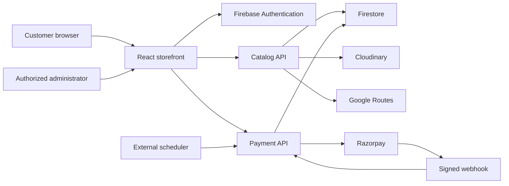

> **Current shipping status (11 November 2026):** `DISTANCE_DELIVERY_ENABLED=false` by default. New checkout uses the existing saved flat shipping configuration, before coupons/points, with free shipping strictly above its saved threshold. Google Routes, dispatch coordinates, slabs and distance quotes are inactive. Historical order charges are unchanged. Distance-specific material below describes a retained, inactive implementation until a future explicitly approved re-enable. See [current flat shipping reference](FLAT_SHIPPING.md).

# Project overview

Baseline: 11 November 2026; local HEAD `405716c` plus existing distance-delivery working-tree changes. Production parity: **Pending confirmation**. Start at the [documentation index](README.md).

## Purpose and identity

Parinaya Sarees is a customer storefront and separate authenticated administration application for selling sarees, managing catalog/stock, accepting orders and maintaining customer relationships. Visible branding is defined in `src/config/brand.ts` as Parinaya Sarees. The repository name and Firebase project remain `parinaya-silks`; do not rename infrastructure identifiers to match display branding.

## Stack and structure

| Area | Implementation | Main location |
| --- | --- | --- |
| Customer/Admin UI | React 19, TypeScript, Vite, Tailwind and module CSS; existing local Lora typography | `src/App.tsx`, `src/views/`, `src/admin/` |
| Routing | Application-managed history/popstate navigation with legacy hash handling; not React Router | `src/App.tsx`, `src/utils/routing.ts`, `src/admin/accessPolicy.ts` |
| Authentication/data | Firebase browser SDK; trusted Firebase Admin backend; Firestore `(default)` in `parinaya-silks` | `src/services/firebase/`, `server/firebase.ts` |
| API hosting | Vercel catalog function and dynamic payment function | `api/catalog.ts`, `api/payments/[action].ts`, `vercel.json` |
| Media | Signed and server-verified Cloudinary uploads | `server/cloudinary.ts`, module media editors |
| Payments | Razorpay TEST/LIVE support, signed verification/webhooks and scheduled recovery | `server/payments/`, `src/payments/` |
| Delivery | Server Google Routes driving quote; optional Leaflet/OpenStreetMap pin picker | `server/routes.ts`, `server/deliveryQuotes.ts`, `src/delivery/LocationPicker.tsx` |
| Analytics | Optional consented GA4 manual page views | `src/analytics/`, `src/content/Seo.tsx` |
| Verification | Node tests, Firebase emulators, Python Playwright and packaged-runtime checks | `scripts/`, module `*.test.ts`/`*.test.tsx` |

`package.json` and the lockfile are the version reference. Existing setup records name Node 22.22.2/npm 10.9.7; the current hosted Node runtime is **Pending confirmation**.

## Functional areas

- Storefront: categories, search/filters, product information/images/variants, Wishlist, Bag, Buy Now, campaigns and coupon discovery.
- Customer: email/password account, required registration contact, addresses, checkout, order history/progress, supported cancellation/return requests and loyalty balances/history.
- Administration: dashboard, categories, products, inventory, orders/bulk workflow, customers/exports, coupons, campaigns, banners, website content, contact, About, enquiries and settings.
- Commerce: trusted totals, coupon eligibility, loyalty redemption/earning, COD, online reservations, payment reconciliation and provider refund tracking.
- Delivery: saved flat fee and strict pre-coupon free-shipping threshold; COD availability remains independent. Dispatch/slabs/Routes are retained but inactive.

## System flow

The optional map's OSM tiles and opted-in GA4 requests are browser connections. Google Routes calculations and payment secrets stay on the server. See [architecture](technical/architecture.md) for trust boundaries.

## Boundaries

Flat checkout uses saved shipping settings and does not depend on Google Routes. Distance delivery is retained behind a server-only opt-in, disabled by default. No pickup option or independent Admin online-payment switch is present. Existing accepted orders retain snapshots.

Courier information and tracking URLs are managed manually; this documentation does not claim booking, label generation or carrier synchronization. Support WhatsApp/email/phone actions are links. No automated customer order email/SMS/WhatsApp delivery is established by the inspected integration. Refund initiation, replacement-exchange automation and billing/inventory-software synchronization must not be promised.

GA4 page views do not constitute ecommerce purchase/refund tracking. A separate reports component exists in source but is not mounted as a standalone Admin screen. Use the actual dashboard and available module exports.

Policy UI/content management is implemented; business-approved wording is **Pending confirmation**. Current deployed configuration, subscriptions, backups and integration acceptance belong in the [handover register](handover/ownership-acceptance.md).

Sources: `package.json`, `src/config/brand.ts`, `src/App.tsx`, `src/admin/AdminPanel.tsx`, `server/catalog.ts`, `server/payments/`, `server/routes.ts`, `vercel.json`, `firebase.json`. Existing milestone documentation is retained in the index.
